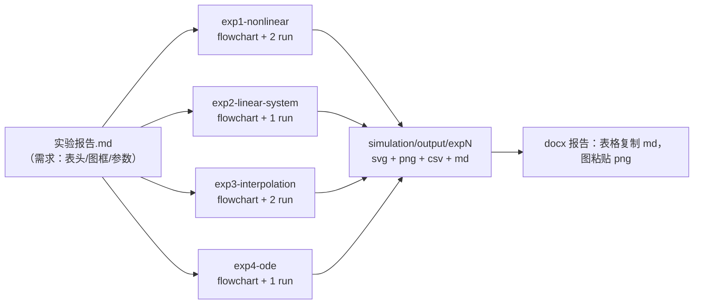

# 数值分析上机实验 · 需求整理与脚本规划

> 来源：`数值实验报告.docx`（哈尔滨工业大学（威海）《数值分析》上机报告，12 页，4 个实验）
> 本文用途：把报告里的硬性要求（表格列头、图框数量、参数、数据）逐条落成"脚本 → 产物 → 报告位置"的对照表，写代码时不必再翻 docx。
> 约定：正文与图内标签用英文/LaTeX，注释与报告文字用中文（同仓库规范）。

---

## 0. 一页速览

| # | 实验题目 | 主题 | 方法 | 报告必须交出的东西 | 建议脚本 |
|---|---|---|---|---|---|
| 1 | 迭代法求解非线性方程 | 单变量方程 + 弹性悬链线非线性方程组 | 二分法、Newton、割线、Newton（2×2） | 流程图（3 种单方程方法）、7 行结果表、2×2 方程组结果表（ε=10⁻³/10⁻⁴） | 3 |
| 2 | 迭代法求解线性方程组 | BTEX 四组分吸光度反演（4×4） | Jacobi、Gauss-Seidel | 两栏并排流程图、结果表（数值解 + 迭代次数）、收敛性比较 | 2 |
| 3 | 数据的插值逼近 | 共晶陶瓷强度–应变 / 低碳钢拉伸 | Lagrange（或 Newton）、三次样条、最小二乘 | 两组流程图、3 个温度的插值多项式与曲线、1/2/3/5 次拟合曲线 | 3 |
| 4 | 常微分方程初值问题 | 二阶状态方程（单输入单输出） | 显式 Euler、隐式 Euler、4 级 4 阶 RK | 流程图、3 方法 × 3 步长的 y(3) 表、状态与输出曲线 | 2 |

每个实验"一图一脚本"：**流程图脚本** + **实验脚本**（实验三、实验一因内容翻倍各拆成两个实验脚本）。

---

## 1. 目录、运行与产物约定

### 1.1 目标结构

```text
6.Mathématiques appliquées/Analyse Numérique/simulation/
├── 实验报告.md                     # 本文（需求与规划，唯一需求源）
├── common.py                       # 共享约定：配色、中文字体、output 落盘、表格输出
├── exp1-nonlinear/
│   ├── flowchart.py                # 二分 / Newton / 割线（+ 方程组 Newton）流程图
│   ├── single-equation.py          # 3.1 单方程：7 行结果表 + 收敛曲线
│   └── catenary.py                 # 3.2 弹性悬链线方程组：2 个误差界的结果表
├── exp2-linear-system/
│   ├── flowchart.py                # Jacobi / Gauss-Seidel 并排流程图
│   └── btex.py                     # BTEX 4×4：结果表 + 收敛比较
├── exp3-interpolation/
│   ├── flowchart.py                # Lagrange / 三次样条 / 最小二乘流程图
│   ├── lagrange-spline.py          # 298/1073/1273 K 的插值多项式与曲线
│   └── least-squares.py            # 低碳钢 1/2/3/5 次多项式拟合
├── exp4-ode/
│   ├── flowchart.py                # 显式 Euler / 隐式 Euler / RK4 流程图
│   └── state-equation.py           # 状态方程：y(3) 表 + X(t)、y(t) 曲线
└── output/                         # 所有产物统一落在这里，按实验再分子目录
    ├── exp1/
    ├── exp2/
    ├── exp3/
    └── exp4/
```

- 目录名用 ASCII、kebab-case（`exp1-nonlinear`），避免空格与中文路径在命令行里反复转义；中文标题写进各脚本 docstring 与报告。
- **共享 `simulation/common.py`**：配色、中文字体、`output/expN` 目录、`svg+png` 落盘、`csv+md` 表格全在这里，实验脚本只写算法。目录名带连字符不能用 `-m`，所以统一在脚本头做路径引导（三行，见 §1.4）。

### 1.2 运行方式

仓库根为 uv 项目，统一在**仓库根**执行（`uv run` 会自动用项目 `.venv`，无需手动激活）：

```bash
uv run "6.Mathématiques appliquées/Analyse Numérique/simulation/exp1-nonlinear/single-equation.py"
```

> 若某个 shell 里提示找不到 `uv`（shim 没进该会话的 PATH），直接用 `C:\Users\Violet\scoop\apps\uv\current\uv.exe` 的绝对路径调用，效果相同。

脚本内不要依赖 `cwd`：`common.py` 用自己的绝对路径定位 `simulation/` 与 `output/`，从任何目录运行都不会写错位置。

### 1.3 产物命名（`output/expN/`）

| 类型 | 命名 | 说明 |
|---|---|---|
| 图（矢量） | `<name>.svg` | 仓库留档、可再缩放 |
| 图（位图） | `<name>.png`，dpi ≥ 200 | 直接粘贴进 docx |
| 结果表（数据） | `<name>.csv` | 列头与报告表格逐字一致 |
| 结果表（可粘贴） | `<name>.md` | 脚本同时把 Markdown 表写到 stdout 与文件，报告表格直接复制 |
| 多项式系数 | `<name>-coeffs.txt` | 实验三需要"给出多项式"，按降幂打印并附自变量说明 |

> 仓库 `.gitignore` 忽略 `output/`、`*.png`、`*.svg`：生成物不入库，只在本机生成并用于贴报告；入库存的是本文与脚本。

建议清单：

```text
output/exp1/flowcharts.{svg,png}        single-equation.{csv,md}   single-equation-convergence.{svg,png}   catenary.{csv,md}
output/exp2/flowcharts.{svg,png}        btex.{csv,md}             btex-convergence.{svg,png}
output/exp3/flowcharts.{svg,png}        lagrange-298.{svg,png}  lagrange-1073.{svg,png}  lagrange-1273.{svg,png}  lagrange-coeffs.txt
output/exp3/fit-degrees.{svg,png}       fit-coeffs.txt             fit-residuals.{svg,png}
output/exp4/flowcharts.{svg,png}        y3-table.{csv,md}          state-curves.{svg,png}   output-curves.{svg,png}
```

### 1.4 依赖、`common.py` 与绘图约定

- **依赖**：`numpy`、`matplotlib` 已在 `pyproject.toml`；`scipy 1.17.1` 已用 `uv add scipy` 加入（pyproject/uv.lock/.venv 均已同步）。三次样条用 `scipy.interpolate.CubicSpline(x, y, bc_type="natural")`；最小二乘仍用 `np.polyfit` / `np.linalg.lstsq`，不必引 scipy。
- **`common.py` 是唯一共享层**（已落地并冒烟验证），脚本里不要再重复定义：

| 名称 | 作用 |
|---|---|
| `BLUE / RED / GRAY / GREEN` | 与 `scripts/*.py` 一致的配色 |
| `OUT_ROOT` | `simulation/output` 的绝对路径 |
| `out_dir(exp)` | 取/建 `output/expN`，返回 `Path` |
| `save(fig, exp, name, dpi=200)` | 同落 `<name>.svg` 与 `<name>.png`，并关闭 figure |
| `write_table(exp, name, header, rows, note=…)` | 同写 `.csv` 与 `.md`（Markdown 表同时打印到 stdout），`float_fmt` 控制浮点格式 |
| 导入即生效 | `matplotlib.use("Agg")`、中文字体 `Microsoft YaHei → SimHei → DejaVu`、`axes.unicode_minus=False`、`svg.fonttype="path"`（svg 换机器打开不变形） |

- 每个实验脚本头统一三行引导，之后 `from common import …`：

  ```python
  import sys
  from pathlib import Path
  sys.path.insert(0, str(Path(__file__).resolve().parents[1]))  # → simulation/
  ```
- **中文字体**是 flowchart 的硬需求：不显式设置的话方框文字会变成方块；`common.py` 已设好，脚本里别再改 `rcParams`（要改只改字号/线宽）。
- 流程图用 `FancyBboxPatch` + `FancyArrowPatch` 手绘（起止用圆角框、判定用菱形、回边用弧线箭头），不引入 graphviz 依赖；画布 `figsize=(9, 12)` 一类竖版，`ax.axis("off")`。
- 停止准则统一写成 **`‖x^(k+1) − x^k‖_∞ < ε`**，同时把残差（`|f(x^k)|` 或 `‖F‖_∞`）一起打印进 CSV 附列，报告里只报主判据得到的迭代次数。
- 数值打印格式：解 `%.10f`，误差/残差 `%.3e`；`write_table` 的默认 `float_fmt="%.6f"` 可按表头需要覆盖。
- 每个脚本 docstring 写清：实验号、小节号（如 3.1.2）、方法、参数、产物路径。

### 1.5 数据流



---

## 2. 实验一　迭代法求解非线性方程

### 2.1 报告原文要点

- **实验目的**：能够应用二分法、Newton 法、割线法求解非线性方程的数值解。
- **报告结构**：3.1 单方程（3.1.1 流程图 / 3.1.2 实验结果 / 3.1.3 结果分析）→ 3.2 弹性悬链线方程组（3.2.1 实验结果）→ 4 思考题。

### 2.2 3.1 单变量方程

方程与精度（原文）：

$$f(x)=x^{3}-6x^{2}+11x-6=0,\qquad \text{真解 } x=1,2,3,\qquad \varepsilon<10^{-4}$$

3.1.2 结果表（**列头必须一致**）：

| 数值方法 | 初始值 $x_0$ | 方程的数值解 | 迭代次数 $n$ |
|---|---|---|---|
| 二分法 | 0.5 | | |
| Newton 法 | 0.5 | | |
| Newton 法 | 0.8 | | |
| Newton 法 | 1.5 | | |
| Newton 法 | 1.8 | | |
| Newton 法 | 2.5 | | |
| Newton 法 | 2.8 | | |

要求与空白点：

1. 3.1.1 要"程序流程图"——**三种方法都要有**（二分、Newton、割线），建议一张三面板竖图或三张小图。
2. 表中**没有割线法行**，但实验目的明确要求割线法 → 在 `single-equation.md` 里补一行/补一张小表（初值取 $x_0=1.5,\ x_1=1.8$ 或 $2.5,2.8$，脚本里注明），报告里作为"补充结果"放在原表下方。
3. 二分法只给了"初始值 0.5"，**没给区间** → 脚本取 $[a_0,b_0]=[0.5,1.5]$（$f(0.5)<0<f(1.5)$），并把区间写进 CSV 与图注，报告里注明所用区间（否则"初始值 0.5"无法复现）。
4. 割线法需要两个初值，表格只有一个 → 同上，在附注里说明。

### 2.3 3.2 弹性悬链线理论非线性方程组

（据 王健、杨雨豪，斜拉桥无应力索长实用迭代算法，2020）

$$
\begin{cases}
f(x,y)= y+\dfrac{H}{EA}\operatorname{sh}y-x-\dfrac{H}{EA}\operatorname{sh}x-\dfrac{l}{\xi}=0\\[4pt]
g(x,y)= \operatorname{ch}y+\dfrac{H}{2EA}\operatorname{sh}^{2}y-\operatorname{ch}x-\dfrac{H}{2EA}\operatorname{sh}^{2}x-\dfrac{h}{\xi}=0
\end{cases}
$$

参数：$\dfrac{H}{EA}=0.0015$，$l=200$，$h=250$，$\xi=3500$；初值 $x_0=1,\ y_0=1.5$。

3.2.1 结果表：

| 初始值 | 方程的数值解 | 迭代次数 $n$ | 误差界 |
|---|---|---|---|
| $x_0=1,\ y_0=1.5$ | | | $\varepsilon=10^{-3}$ |
| $x_0=1,\ y_0=1.5$ | | | $\varepsilon=10^{-4}$ |

要点：

- 同一初值跑两遍，**只改误差界**，用于观察迭代次数随精度的变化（Newton 二次收敛：1e-3→1e-4 一般只多 1 步）。
- 报告未要求流程图；`catenary.py` 里顺手输出一个 2×2 Newton 迭代框图（`output/exp1/catenary-flowchart.svg`）作为可选附录，不影响主表。

### 2.4 脚本与产物

| 脚本 | 内容 | 产物 |
|---|---|---|
| `exp1-nonlinear/flowchart.py` | 4 面板：二分法（`while (b-a)/2>ε`）、Newton（`x_{k+1}=x_k-f/f'`）、割线（两点差商）、方程组 Newton（`X_{k+1}=X_k-J^{-1}F`） | `output/exp1/flowcharts.{svg,png}` |
| `exp1-nonlinear/single-equation.py` | 7 行主表 + 割线补充行；每行记录初值、解、$n$、$\|f(x_n)\|$、是否收敛到的根；画误差–迭代曲线 | `single-equation.{csv,md}`、`single-equation-convergence.{svg,png}` |
| `exp1-nonlinear/catenary.py` | 解析 Jacobian 的 2×2 Newton；$\varepsilon=10^{-3},10^{-4}$ 两次；记录 $\|F\|_\infty$、$\|\Delta X\|_\infty$ | `catenary.{csv,md}`、`catenary-flowchart.{svg,png}`（可选） |

解析 Jacobian（直接用，别做数值差分；$c=H/EA=0.0015$）：

$$
J=\begin{pmatrix}
-1-c\operatorname{ch}x & 1+c\operatorname{ch}y\\
-\operatorname{sh}x-c\operatorname{sh}x\operatorname{ch}x & \operatorname{sh}y+c\operatorname{sh}y\operatorname{ch}y
\end{pmatrix}
$$

### 2.5 结果分析要点（报告 3.1.3）

（1）**初值的影响**：$f'(x)=3x^2-12x+11$ 在 $x=1.5$ 与 $x=2.5$ 处取值 $-0.25$，几乎是驻点。这两个初值会让 Newton 一步跳到另一支：

| $x_0$ | $f(x_0)$ | $f'(x_0)$ | Newton 首步 | 收敛到 |
|---|---|---|---|---|
| 0.5 | −1.875 | 5.75 | 0.826 | 1 |
| 0.8 | −0.528 | 3.32 | 0.959 | 1 |
| 1.5 | 0.375 | **−0.25** | **3.000** | **3** |
| 1.8 | 0.192 | −0.88 | 2.018 | 2 |
| 2.5 | −0.375 | **−0.25** | **1.000** | **1** |
| 2.8 | −0.288 | 0.92 | 3.113 | 3 |

结论可以写成：初值离目标根越远、且落在 $|f'|$ 很小处时，Newton 会把点抛到另一个根附近（本例 1.5→3、2.5→1），迭代次数反而更少但"解"换了根；二分法只依赖区间端点符号，与初值位置无关但线性收敛。

（2）**方法比较**：二分法误差按 $2^{-k}$ 线性下降（本例 13 步到半宽 $10^{-4}$）；Newton 二次收敛（3–4 步到 $10^{-4}$）但依赖导数与非奇异初值；割线法收敛阶 $\approx1.618$，不需导数、需两个初值。三者给出的数值解都应落在 $1,2,3$ 附近（误差 $<10^{-4}$），差别在步数与稳健性。

### 2.6 坑

- $f(1.5)=0.375$ 不算小，但 $f'=-0.25$，一步就跨到 3；分析里要说清"导数近零"而非"函数值近零"。
- 二分法在 $f(1)=0$ 处会立即命中；若取 $[0.5,1.5]$，中点 $1.0$ 恰好是根，脚本要允许"中点即根"提前退出，同时保持迭代次数定义一致（命中那一步也算一次）。
- 割线法分母 $f(x_k)-f(x_{k-1})$ 要加保护（`abs(...) < 1e-14` 时终止并标注）。
- 结果表里"方程的数值解"要写到 $10^{-4}$ 以上精度，别只打 4 位小数导致判据看起来不满足。

---

## 3. 实验二　迭代法求解线性方程组

### 3.1 报告原文要点

- **实验目的**：能够应用 Jacobi 迭代法、Gauss-Seidel 迭代法求解线性方程组，分析方法的收敛性。
- **报告结构**：3.1 问题简述 → 3.2 程序流程图（两栏并排）→ 3.3 实验结果 → 3.4 结果分析 → 4 思考题（2 问）。

### 3.2 模型与数据

朗伯–比尔定律加和性：$A_i=\sum_{j=1}^{n}\varepsilon_{ij}c_j b$（$b$ 为比色皿厚度，此处并入系数）。

表 1（不同波长下各化合物的摩尔吸光系数与混合物吸光度，单位 $\mathrm{dm^3\cdot mol^{-1}\cdot cm^{-1}}$）：

| 波长/nm | 对二甲苯 | 邻二甲苯 | 间二甲苯 | 乙苯 | 混合物吸光度 |
|---|---|---|---|---|---|
| 12.5 | 1.5020 | 0 | 0.0514 | 0.0408 | 0.10130 |
| 13.0 | 0.0261 | 0 | 1.1516 | 0.0320 | 0.09943 |
| 13.4 | 0.0342 | 2.5320 | 0.0355 | 0.2933 | 0.21940 |
| 14.3 | 0.0340 | 0 | 0.0684 | 0.3470 | 0.03396 |

> 原表波长写作 12.5/13.0/13.4/14.3 nm，量纲上疑似漏了百位（212.5 nm 一类），不影响方程组与求解，报告里可原样照抄。

待解方程组（$x_1,\dots,x_4$ 依次为对、邻、间二甲苯与乙苯的浓度，$\mathrm{mol\cdot dm^{-3}}$）：

$$
\begin{cases}
1.5020x_1+0.0514x_3+0.0408x_4=0.1013\\
0.0261x_1+1.1516x_3+0.0320x_4=0.09943\\
0.0342x_1+2.5320x_2+0.0355x_3+0.2933x_4=0.2194\\
0.0340x_1+0.0684x_3+0.3470x_4=0.03396
\end{cases}
$$

系数矩阵与右端项（直接抄进脚本，避免手误）：

```csv
A_row1,1.5020,0,0.0514,0.0408,b,0.1013
A_row2,0.0261,0,1.1516,0.0320,b,0.09943
A_row3,0.0342,2.5320,0.0355,0.2933,b,0.2194
A_row4,0.0340,0,0.0684,0.3470,b,0.03396
```

### 3.3 报告要求

| 位置 | 要求 | 落地方式 |
|---|---|---|
| 3.2 程序流程图 | 一张表格框，左"Jacobi 迭代法"、右"Gauss-Seidel 迭代法"，两栏等高 | `flowchart.py` 一张 1×2 面板图 |
| 3.3 实验结果 | 表列：数值方法 / 方程的数值解 / 迭代次数 $n$；下方"误差上限为：____" | `btex.md` 输出该表 + 一行"误差上限 ε=1e-6" |
| 3.3 误差上限 | 原文空白，需自定 | 取 $\varepsilon=10^{-6}$（$\|\Delta x\|_\infty$），另附 $\|Ax-b\|_\infty$ 供参考 |
| 3.4 结果分析 | 比较两方法结果的区别 | 迭代次数、谱半径、收敛速度对比 |
| 4 思考题(2) | 如何判定迭代终止 | 判据 + 与 $\|B\|$、谱半径的关系，写进 md 的备注区 |

### 3.4 脚本与产物

| 脚本 | 内容 | 产物 |
|---|---|---|
| `exp2-linear-system/flowchart.py` | 左右两栏；Jacobi 用"旧向量整体更新"，G-S 用"逐个分量就地更新"（这个差别要在图里画出来） | `output/exp2/flowcharts.{svg,png}` |
| `exp2-linear-system/btex.py` | 组装 $A,b$；**行交换后**再迭代；两法各跑一遍，输出数值解、$n$、$\rho(B)$、残差；画误差–迭代半对数图 | `btex.{csv,md}`、`btex-convergence.{svg,png}` |

代码要点：

$$
x_i^{(k+1)}=\frac{1}{a_{ii}}\Big(b_i-\sum_{j\ne i}a_{ij}x_j^{(k)}\Big)\ \ (\text{Jacobi}),\qquad
x_i^{(k+1)}=\frac{1}{a_{ii}}\Big(b_i-\sum_{j<i}a_{ij}x_j^{(k+1)}-\sum_{j>i}a_{ij}x_j^{(k)}\Big)\ \ (\text{G-S})
$$

### 3.5 关键坑（必须处理，否则程序直接崩）

1. **$a_{22}=0$**：邻二甲苯只在第 3 个方程出现，矩阵对角线上第 2 个元素为 0。Jacobi/G-S 的公式要除以 $a_{ii}$ → 除零。
   处理：**交换第 2、3 个方程**（行置换 $P=(1,3,2,4)$），置换后对角线 $(1.5020,\ 2.5320,\ 1.1516,\ 0.3470)$ 严格对角占优，$\rho(B_J)\approx0.105$，两法都收敛。报告里必须写明"为保证对角元非零，先交换第 2、3 行，解向量次序相应还原"。
2. 不交换也可用，但要在报告里承认"Jacobi 无法直接进行"，属于不推荐做法；脚本默认交换。
3. 初值取 $x^{(0)}=\mathbf{0}$，两法必须用同一初值与同一判据，否则迭代次数不可比。
4. 结果行的"方程的数值解"是 4 个分量，CSV 给 4 列（`x1..x4`），md 表里拼成一格 `(0.0626, 0.0759, 0.0828, 0.0754)`。
5. 收敛性分析最好给 $\rho(B_J)$ 与 $\rho(B_{GS})$（用 `np.linalg.eigvals` 求），比"G-S 步数少"更有说服力。

---

## 4. 实验三　数据的插值逼近

### 4.1 报告原文要点

- **实验目的**：对于得到的实验数据，能够构造适合的拟合函数反映其内在规律。
- **结构**：3.1 Lagrange 插值（或 Newton 插值）→ 3.1.2 算法流程图 → 3.1.3 实验结果（3 个温度）→ 3.2 最小二乘多项式拟合 → 3.2.2 流程图 → 3.2.3 结果（1/2/3/5 次）。

### 4.2 3.1 插值（共晶陶瓷）

表 1（不同温度下 Al₂O₃/YAG:Ce³⁺ 共晶陶瓷的弯曲强度与应变）：

| 温度/K | 弯曲强度/MPa | 应变/% | 均值 |
|---|---|---|---|
| 298 | 314, 329, 341, 360, 372 | 0.734, 0.738, 0.747, 0.755, 0.768 | 343±20.8 MPa；0.75±0.01% |
| 1073 | 308, 331, 320, 357, 365 | 0.692, 0.778, 0.745, 0.967, 0.969 | 338±20.4 MPa；0.83±0.12% |
| 1273 | 261, 332, 335, 365, 378 | 0.653, 0.796, 0.703, 0.724, 0.841 | 334±40.6 MPa；0.74±0.07% |

要求：对**每个温度**的 5 组数据分别构造

1. Lagrange 插值多项式（4 次，5 点唯一确定；也可用 Newton 差商，等价）；
2. 三次样条插值多项式（自然边界）；
3. 两条曲线画在同一张图（原始散点 + Lagrange + 样条），并给出多项式表达式。

3.1.3 的输出是**三个竖排图框**，各自贴"298 K / 1073 K / 1273 K 时插值多项式 + 图像" → 每个温度一张图，多项式写在图内或用 LaTeX 文本写在报告正文。

自变量约定：**$x$ = 应变（%），$y$ = 弯曲强度（MPa）**（与"应力–应变"习惯一致；若反过来，多项系数与图形完全不同，报告里要统一说明）。曲线横轴范围取 $[\min x-0.02,\ \max x+0.02]$ 或略宽，不要只连 5 个点。

### 4.3 3.2 最小二乘（低碳钢拉伸）

36 组 $(s,F)$，$s$ 为拉伸程度/mm，$F$ 为力/N：

```csv
s,F
1,10838
2,19123
3,28447.08
3.5,25946.35
4,25859.64
4.5,25895.24
5,25136.25
5.5,25346.2
6,24831.84
7,27896.14
8,29234.71
9,30859.45
10,31741.14
11,32045.36
12,32896.63
13,33748.65
14,33956.47
15,34029.52
16,34212.66
17,34512.21
18,34895.63
19,34984.63
20,35213.34
21,35489.47
22,35669.21
23,35675.14
24,35702.36
25,35711.92
26,35714.12
27,35701.25
28,35641.84
29,35148.15
30,34214.36
31,33021.15
32,30541.65
33,27584.31
```

要求：做 **1、2、3、5 次**多项式最小二乘拟合，给出 4 张图（报告里是 2×2 的四个框），每张含散点、拟合曲线、次数与系数、$R^2$（或残差平方和）。

### 4.4 脚本与产物

| 脚本 | 内容 | 产物 |
|---|---|---|
| `exp3-interpolation/flowchart.py` | 3 面板：Lagrange（双重循环 + 基函数）、三次样条（解三对角）、最小二乘（构造范德蒙 / 法方程 + 求解） | `output/exp3/flowcharts.{svg,png}` |
| `exp3-interpolation/lagrange-spline.py` | 3 个温度各一张图；Lagrange 系数（中心化后）与样条系数一并打印；图内注明 $R^2$ 类指标不适用（插值过点） | `lagrange-{298,1073,1273}.{svg,png}`、`lagrange-coeffs.txt` |
| `exp3-interpolation/least-squares.py` | 4 个次数拟合同一张 2×2 图；打印每次的系数、残差平方和、$R^2$；另出残差图 | `fit-degrees.{svg,png}`、`fit-coeffs.txt`、`fit-residuals.{svg,png}` |

### 4.5 坑与要点

1. **量纲病态**：298 K 的 $x$ 只在 $[0.734,0.768]$ 内，直接对 $x$ 建 4 次多项式，系数会到 $10^{8}$ 量级（实测 $\sim-4.7\times10^{8}$），图上和报告里都没法看。
   → 用中心化/缩放变量 $t=(x-\bar x)/h$（$\bar x$ 为均值、$h$ 为半跨度），先算 $t$ 上的系数，再说明"以 $t$ 为自变量"；或把应变写成 $10^{-3}$ 单位。报告里必须交代变量变换，否则系数无意义。
2. **1073 K 数据非单调**：$0.778\%\to0.745\%$ 处强度从 331 掉到 320，$0.967/0.969$ 两点明显偏离均值（均值 $0.83\pm0.12\%$）。4 次 Lagrange 在端点附近会摆动，这正是"高次插值不稳定"的现成例子，分析里要点出来。
3. 三次样条直接用 `scipy.interpolate.CubicSpline(x, y, bc_type="natural")`（`scipy` 已装）；节点只有 5 个，不需要自己搭三对角系统。
4. 最小二乘用 `np.polyfit(x, y, deg)`（内部 SVD/缩放较稳），再用 `np.polyval` 画曲线；5 次拟合在 $s\in[1,33]$ 上会为了追颈缩段而在两端翘，残差图能说明"全局多项式不适合分段力学行为"。
5. 报告要求"多项式"——系数按降幂打印，并标注自变量（原始 $x$ 还是中心化 $t$）。

---

## 5. 实验四　常微分方程初值问题

### 5.1 报告原文要点

- **实验题目/目的**：常微分方程初值问题；应用数值方法求解。
- **结构**：3.1 问题简述 → 3.2 算法流程图 → 3.3 实验结果（表 + 曲线）→ 4 结果分析（2 问）。

### 5.2 模型

$$
\begin{cases}
\dot X(t)=F(t,X,u)=AX(t)+bu(t)\\
y(t)=cX(t)\\
X(0)=\mathbf{0}
\end{cases}
\qquad t\in[0,3]
$$

$$
X(t)=\begin{pmatrix}X_1(t)\\X_2(t)\end{pmatrix},\quad
b=\begin{pmatrix}0\\1\end{pmatrix},\quad
A=\begin{pmatrix}0&1\\-\omega_n^2&-2\xi\omega_n\end{pmatrix},\quad
c=\begin{pmatrix}\omega_n^2&0\end{pmatrix},\quad
u(t)=1
$$

$\omega_n=10\ \mathrm{rad/s}$，$\xi=0.2,\ 0.5,\ 0.707,\ 0.9$，步长 $h=1,\ 0.5,\ 0.25$。

3.3 结果表：

| 数值方法 | 步长 $h$ | $y(3)$ | 步长 $h$ | $y(3)$ | 步长 $h$ | $y(3)$ |
|---|---|---|---|---|---|---|
| 显式 Euler 方法 | 1 | | 0.5 | | 0.25 | |
| 隐式 Euler 方法 | 1 | | 0.5 | | 0.25 | |
| 4 级 4 阶 Runge-Kutta 公式 | 1 | | 0.5 | | 0.25 | |

另需"给出一组状态变化曲线和输出变化曲线图"（建议每个 $\xi$ 一张 2×2：上排 $X_1,X_2$，下排 $y$ 与精确解对比）。

### 5.3 脚本与产物

| 脚本 | 内容 | 产物 |
|---|---|---|
| `exp4-ode/flowchart.py` | 3 面板：显式 Euler（前向）、隐式 Euler（每步解 $(I-hA)X_{k+1}=X_k+hbu$）、RK4（四段斜率） | `output/exp4/flowcharts.{svg,png}` |
| `exp4-ode/state-equation.py` | 3 方法 × 3 步长 × 4 阻尼比全跑；表按报告只取一个 $\xi$（默认 0.2，CSV 里 4 个全给）；画 $X_1,X_2,y$ 与精确解 | `y3-table.{csv,md}`、`state-curves.{svg,png}`、`output-curves.{svg,png}` |

方法公式（$f(t,X)=AX+bu$，$u\equiv1$）：

$$
\begin{aligned}
&\text{显式 Euler:} && X_{k+1}=X_k+h(AX_k+b)\\
&\text{隐式 Euler:} && X_{k+1}=X_k+h(AX_{k+1}+b)\ \Rightarrow\ (I-hA)X_{k+1}=X_k+hb\\
&\text{RK4:} && X_{k+1}=X_k+\tfrac{h}{6}(k_1+2k_2+2k_3+k_4),\quad k_1=f(X_k),\ k_2=f(X_k+\tfrac h2k_1),\dots
\end{aligned}
$$

精确解（用于对照与误差）：$\omega_d=\omega_n\sqrt{1-\xi^2}$，

$$
y(t)=1-e^{-\xi\omega_n t}\Big(\cos\omega_d t+\frac{\xi\omega_n}{\omega_d}\sin\omega_d t\Big),
\qquad
X_1=y/\omega_n^2
$$

### 5.4 稳定性：本实验真正的考点

对 $u\equiv1$，系统矩阵特征值 $\lambda_{1,2}=-\xi\omega_n\pm j\omega_d$，且 $|\lambda|=\omega_n=10$（与 $\xi$ 无关）。于是 $h|\lambda|=10,\ 5,\ 2.5$：

| 方法 | 绝对稳定域（实部为负时） | $h=1$ | $h=0.5$ | $h=0.25$ |
|---|---|---|---|---|
| 显式 Euler | $|1+h\lambda|<1$，即 $h|\lambda|<2$ | 10 → 发散 | 5 → 发散 | 2.5 → 发散 |
| RK4 | $h|\lambda|\lesssim2.785$ | 10 → 发散 | 5 → 发散 | 2.5 → **勉强稳定** |
| 隐式 Euler | 无条件稳定（A-稳定） | 稳定 | 稳定 | 稳定 |

所以表里显式 Euler 的 $y(3)$ 会是 $10^{7}$ 量级的爆炸值（不是错，正是结论）；RK4 只有 $h=0.25$ 给出可用值；隐式 Euler 三档都收敛到真值附近。

参考真值：$y(3)=1.001536$（$\xi=0.2$，有超调），其余 $\xi$ 下 $y(3)=1.000000$（$e^{-30}$ 已衰减完）。

### 5.5 结果分析要点（报告 4）

1. **收敛性比较**：显式 Euler 一阶、条件稳定；隐式 Euler 一阶、A-稳定、每步需解 2×2 线性系统；RK4 四阶、稳定域更大但仍有 $h\lesssim0.2785$ 的限制。用上表说明"同一 $h$ 下稳定性差异比精度差异更致命"。
2. **步长影响**：$h$ 减半，显式 Euler 的误差只降一半（一阶），且只要 $h>0.2$ 就始终发散；RK4 误差按 $h^4$ 下降，$h=0.5\to0.25$ 时从发散变为可用。可再补一条 $h=0.1$ 的曲线说明"稳定后精度才谈得上"。
3. 表格只留了一组 $y(3)$ 列，**没说对应哪个 $\xi$** → 默认 $\xi=0.2$ 并在表下注明；CSV 同时给 4 个 $\xi$ 的完整结果，报告可在附录补一张表。

---

## 6. 需求 → 脚本 → 产物 对照清单

| 实验 | 报告小节 | 要求 | 脚本 | 产物 | 报告位置 |
|---|---|---|---|---|---|
| 1 | 3.1.1 | 二分/Newton/割线流程图 | `exp1-nonlinear/flowchart.py` | `exp1/flowcharts.png` | 3.1.1 空白区 |
| 1 | 3.1.2 | 7 行结果表 + 割线补充 | `single-equation.py` | `single-equation.md/.csv` | 3.1.2 表 |
| 1 | 3.1.3(1)(2) | 初值影响、方法比较 | 同上（收敛曲线） | `single-equation-convergence.png` | 3.1.3 正文 |
| 1 | 3.2.1 | 2 个误差界的结果表 | `catenary.py` | `catenary.md/.csv` | 3.2.1 表 |
| 2 | 3.2 | Jacobi/G-S 并排流程图 | `exp2-linear-system/flowchart.py` | `exp2/flowcharts.png` | 3.2 表格框 |
| 2 | 3.3 | 数值解 + 迭代次数 + 误差上限 | `btex.py` | `btex.md/.csv` | 3.3 表 |
| 2 | 3.4 | 两法结果比较 | 同上 | `btex-convergence.png` | 3.4 正文 |
| 3 | 3.1.2 | 算法流程图 | `exp3-interpolation/flowchart.py` | `exp3/flowcharts.png` | 3.1.2 空白区 |
| 3 | 3.1.3 | 3 个温度的多项式 + 图 | `lagrange-spline.py` | `lagrange-{T}.png`、`lagrange-coeffs.txt` | 3.1.3 三个框 |
| 3 | 3.2.2 | 流程图 | `flowchart.py` | 同上（第 3 面板） | 3.2.2 空白区 |
| 3 | 3.2.3 | 1/2/3/5 次拟合 4 图 | `least-squares.py` | `fit-degrees.png` | 3.2.3 2×2 框 |
| 4 | 3.2 | 算法流程图 | `exp4-ode/flowchart.py` | `exp4/flowcharts.png` | 3.2 空白区 |
| 4 | 3.3 | 3×3 的 $y(3)$ 表 | `state-equation.py` | `y3-table.md/.csv` | 3.3 表 |
| 4 | 3.3 | 状态 + 输出曲线 | 同上 | `state-curves.png`、`output-curves.png` | 3.3 表下 |
| 4 | 4(1)(2) | 收敛性、步长影响 | 同上 | 稳定性表（md 附列） | 4 正文 |

---

## 7. 假设与待确认

| # | 问题 | 当前默认（写进报告时注明） | 影响 |
|---|---|---|---|
| 1 | 二分法"初始值 0.5"没有区间 | 取 $[0.5,1.5]$ | 迭代次数（约 13 步） |
| 2 | 割线法初值表里没有 | 取 $x_0=1.5,x_1=1.8$（另在 CSV 附 $2.5,2.8$ 一组） | 补充行数值 |
| 3 | 实验二误差上限空白 | $\varepsilon=10^{-6}$（$\|\Delta x\|_\infty$） | 迭代次数 7 / 4 |
| 4 | 实验二 $a_{22}=0$ | 交换第 2、3 行后再迭代 | 能否直接套 Jacobi |
| 5 | 实验三插值自变量方向 | $x$=应变%、$y$=强度 MPa | 多项式系数与图形 |
| 6 | 三次样条依赖 | 已 `uv add scipy`（1.17.1），用 `CubicSpline(bc_type="natural")` | 无需手写样条 |
| 7 | 实验四表中 $y(3)$ 对应 $\xi$ | 默认 0.2，CSV 给全部 4 个 | 表格一列的值 |
| 8 | 图尺寸/字体 | PNG dpi=200，中文字体 Microsoft YaHei，图内标签英文 | 贴入 Word 的清晰度 |

需要用户拍板的只有第 1、2、5、7 项；其余都能按上表默认推进。

---

## 8. 自检基准（脚本跑完对一下数量级，不是报告答案）

| 量 | 参考值 | 用途 |
|---|---|---|
| $f(x)$ 的三个根 | 1, 2, 3 | 结果表每行必须落在其中之一 |
| Newton 从 0.5 / 0.8 的极限 | 1 | 迭代 4 / 3 步（$\varepsilon=10^{-4}$，$|f|$ 判据） |
| Newton 从 1.5 的首步 | 3.000（一步跨根） | 解释初值敏感性 |
| Newton 从 2.5 的首步 | 1.000（一步跨根） | 同上 |
| 割线 (1.5,1.8) | 2，约 3 步 | 补充行 |
| 悬链线方程组解 | $x\approx1.018984,\ y\approx1.075990$，残差 $\sim10^{-16}$ | 结果表 |
| 悬链线 Newton 迭代 | 5 步到机器精度；$\varepsilon=10^{-3}$ 约 3 步 | 迭代次数合理性 |
| BTEX 解 | $(0.06256,\ 0.07591,\ 0.08283,\ 0.07541)$ | 结果表 4 个分量 |
| BTEX 置换后 $\rho(B_J)$ | $\approx0.105$ | 收敛性分析 |
| BTEX 迭代数（$\varepsilon=10^{-6}$） | Jacobi 7、G-S 4 | 结果表 |
| 298 K 插值系数（原变量 $x$） | $\sim-4.7\times10^{8}$（4 次项） | 说明必须中心化 |
| $y(3)$ 精确值 | 1.001536（$\xi=0.2$）；1.000000（其余） | 隐式 Euler / RK4 对照 |
| $h|\lambda|$ | 10 / 5 / 2.5（$h=1/0.5/0.25$） | 稳定性结论 |

---

## 9. 报告填写提醒

- 每张图下方图注写清：方法、参数（初值/步长/阻尼比）、判据；图里不要放中文标题，用英文或 LaTeX，避免字体缺失。
- 表格直接复制 `*.md` 的 Markdown 表，列头已与报告一致；"方程的数值解"一格多分量时用 `(x1, x2, x3, x4)`。
- 流程图里必须有：输入、判定菱形、循环回边、终止条件、输出；仅"开始→计算→结束"会被扣分。
- 实验一、二、四的思考题要写"遇到的真实问题"（如除零、脏数据、发散），本文 §2.6、§3.5、§4.5、§5.4 已列好素材。
- 四个实验的"上机时间"栏统一最后填。
